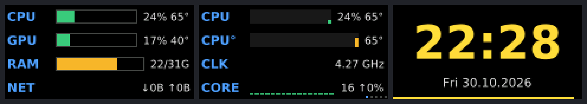
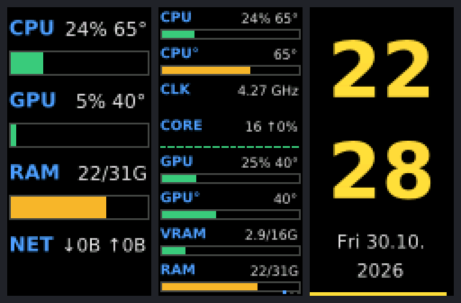

# Open MSU2_MINI

Open-source driver and control app for the **MSU2 / MSU2_MINI** USB screen, a 160×80
pixel LCD (ST7735S) driven by a WCH CH32X035 microcontroller, USB ID `1a86:fe0c`.
It replaces the vendor's Windows-only demo tool and runs on **Linux, Windows and macOS**.

- **Screen mirroring at up to ~60 fps** (the vendor tool manages about 20). You can mirror
  a whole monitor, a window, or a part of the screen.
- **Customisable system monitor** with 17 values: CPU, per-core load, clock speed, GPU, VRAM,
  temperatures, RAM, swap, disk space and speed, network, battery, load, processes, uptime and
  time. Shown as bars, history graphs or plain numbers, in any order, with pages when they
  don't fit on one screen.
- **Clock** and **pictures / animated GIFs**.
- **Writes to the device's flash**: the album picture, and the 36-frame animation it plays
  while no PC is connected.
- **Rotation by 0°, 90°, 180° or 270°.** At 90° and 270° the screen can stand upright; the
  system monitor and the clock then use portrait layouts.
- The **button on the device** cycles through the modes.
- **Native window** that follows your desktop theme: GTK on Linux, Win32 with dark mode on
  Windows, Cocoa on macOS.
- **Command line** for running without a window (autostart), flashing and benchmarking.





> Not affiliated with the hardware's manufacturer. The USB protocol was worked out from the
> behaviour of the vendor's tool; see [Protocol](#protocol).

## Install

Download the executable for your system from the
[Releases](../../releases) page, or [build it yourself](#building).

| System | Notes |
|---|---|
| **Linux** x86_64 | Needs glibc 2.39+ (distributions from 2024 on), GTK 3 and PipeWire. Your user must be in the `dialout` group: `sudo usermod -aG dialout $USER`, then log in again. `packaging/linux/install.sh` adds the program, an app-menu entry and optional autostart. |
| **Windows** 10/11 | Just run the `.exe`; no driver needed. |
| **macOS** | Allow "Screen Recording" for the app (or your terminal) to mirror the screen. |

## Usage

Start the program without arguments to open the window. On the command line:

```sh
open-msu2-mini                          # window
open-msu2-mini run                      # no window, saved settings (for autostart)
open-msu2-mini run stats                # modes: mirror stats clock image album animation
open-msu2-mini run mirror --region 0,0,1280,640 --fps 60
open-msu2-mini run stats --rotate 90    # rotation: 0, 90, 180 or 270 (works with run/show/flash)
open-msu2-mini run mirror --fps 0.5     # slowest: one picture every two seconds
open-msu2-mini run mirror --monitor 1   # Windows/macOS: mirror the second monitor
open-msu2-mini run mirror --reselect    # Linux: choose the shared screen/window again
open-msu2-mini show cat.gif             # show a picture or GIF
open-msu2-mini flash album photo.jpg    # store the album picture on the device
open-msu2-mini flash animation clip.gif # or a folder with A0.png ... A35.png
open-msu2-mini test                     # test pattern
open-msu2-mini bench --mirror           # measure the frame rate
open-msu2-mini --help
```

- **Wayland:** the first time you mirror, your desktop asks which screen or window to
  share. The choice is remembered.
- **Speed limit:** the window marks each choice by what the device can deliver:

  | Mark | Speed limit | Meaning |
  |---|---|---|
  | eco | 0.5–5 fps | Saves CPU and USB bandwidth; motion looks choppy |
  | ✓ full screen | 10–24 fps | Reached for any content, even full-screen video |
  | ◐ partial changes | 30–60 fps | Reached when parts of the screen change; full-screen changes stay at ~25 fps |
  | ⚠ small changes only | 90–120 fps | Above the panel's ~61 fps limit: only small changes (mouse, small video) reach it; more CPU |

- **System monitor:** choose the values, their order and the look under *System monitor →
  Customize…* in the window (or edit the `stats` section of the settings file).
- **Rotation:** pictures stored on the device (album, offline animation) are turned when they are
  written, so write them again after switching between landscape and portrait.
- **Scaling:** the panel is 2:1. `crop` fills it and cuts off the edges, `fit` adds black
  bars, `stretch` distorts.
- **Settings:** stored in `~/.config/open-msu2-mini/` (Linux), `%APPDATA%\open-msu2-mini\`
  (Windows) or `~/Library/Application Support/open-msu2-mini/` (macOS).
- **Window and background instance:** if `open-msu2-mini run` is running in the background,
  the window takes the device over while it is open and starts the background instance
  again when closed.

## Performance

The link to the panel has two hard limits: about **890 KB/s** over USB, and about **16 ms**
for the LCD to draw a full frame. The vendor tool always sends complete frames. This app:

1. **Sends only changed areas.** Each frame is compared with what the panel shows, and only
   the changed rows and columns are sent.
2. **Uses block deltas.** Pixels travel through a 256-byte buffer on the device that keeps
   its content between blocks. Each block is sent either as "changes against the previous
   block" or as "fill pattern + changes", whichever is smaller.
3. **Streams without waiting for acknowledgements.** A button poll every 200 ms provides
   flow control and keeps the link alive; the device goes offline after ~5 s of silence.
4. **Captures cheaply.** Frames are scaled to 160×80 in the capture thread: PipeWire on
   Linux, DXGI desktop duplication on Windows, AVFoundation on macOS.

Measured on the device with `open-msu2-mini bench`:

| Content | Vendor method | Open MSU2_MINI |
|---|---|---|
| Random noise (worst case) | 23.5 fps | 24.8 fps |
| Scrolling picture | 30.3 fps | 32.7 fps |
| Video in a 64×36 window | 40.2 fps | 134.9 fps |
| Only the mouse pointer moves | 47.3 fps | ~2600 updates/s |
| Mirroring a real desktop (KDE, 2560×1440) | ~20 fps | 43–55 fps |

Full-screen video, where every pixel changes, stays near 25 fps: that is the USB limit for
lossless frames.

## Building

You need Rust (1.95+), CMake and a C++ compiler. wxWidgets is downloaded and compiled
automatically on the first build, which takes a few minutes.

- **Linux:** additionally `clang`, and the development packages for GTK 3, PipeWire,
  libudev and OpenSSL (`apt install libclang-dev libgtk-3-dev libpipewire-0.3-dev
  libudev-dev libssl-dev`).
- **Windows:** Visual Studio Build Tools and Ninja; build from a "Developer PowerShell".
- **macOS:** Xcode command line tools, plus `brew install cmake ninja`.

```sh
cargo build --release                       # target/release/open-msu2-mini
cargo build --release --no-default-features # without the window (no wxWidgets)
```

**Linux and Windows executables from Linux, with Docker** (Ubuntu 24.04 build environment;
Windows is cross-compiled with Zig):

```sh
build/build-all.sh   # writes dist/open-msu2-mini-linux-x86_64 and dist/open-msu2-mini-windows-x86_64.exe
```

GitHub Actions (`.github/workflows/ci.yml`) builds Linux, Windows and macOS (Intel and
Apple Silicon) on every push. A `v*` tag publishes the executables as a release.

### Project layout

| Path | Contents |
|---|---|
| `src/device.rs` | USB protocol, frame encoder, flash access |
| `src/controller.rs` | Background thread: connection, keep-alive, button, modes |
| `src/capture/` | Screen capture (portal + PipeWire on Linux, xcap on Windows/macOS) |
| `src/stats.rs` | System monitor |
| `src/render.rs`, `src/scale.rs` | Clock, pictures, text; scaling to the panel or a portrait canvas |
| `src/gui.rs`, `src/gui_stats.rs` | Window and system monitor settings (wxWidgets) |
| `src/main.rs` | Command line, benchmark |
| `build/` | Docker build environment and scripts |
| `packaging/linux/` | Installer, desktop entry, udev rule |

## Protocol

The device is a USB CDC-ACM serial port (`/dev/ttyACM*`, `COMx`, `/dev/cu.usbmodem*`).
The baud rate is ignored. Every command is 6 bytes. Pixels are RGB565, big-endian.

| Bytes | Meaning |
|---|---|
| `00 'M' 'S' 'N' v v` | Sent every 100 ms by the device while offline (`vv` = firmware version, ASCII) |
| `00 'M' 'S' 'N' 'C' 'N'` | Host handshake; the device echoes it back |
| `02 00 xh xl yh yl` | Set the position |
| `02 01 wh wl hh hl` | Set the size |
| `02 02 fh fl bh bl` | Set the foreground and background colour |
| `02 03 07 00 00 00` | Start a pixel transfer into the rectangle (acknowledged) |
| `02 04 aa bb cc dd` | Fill the 256-byte block buffer with a 32-bit pattern |
| `04 ii d0 d1 d2 d3` | Put 4 bytes at word `ii` (0–63) of the block buffer |
| `02 03 08 01 00 00` | Draw the 256-byte block (`02 03 08 00 nn 00`: only `nn` bytes) |
| `02 03 00 ph pl 00` | Show a picture stored in flash at page `p` |
| `02 03 01 ph pl 00` | Show a 1-bit picture from flash in the set colours |
| `02 03 0A rr 00 00` | Orientation (0 = normal, 1 = rotated 180°) |
| `02 03 0B ch cl 00` | Fill the rectangle with a colour |
| `03 00 a2 a1 a0 00` | Read the flash byte at address `a`; the reply's last byte is the value |
| `03 02 ph pl nh nl` | Erase `n` flash pages starting at page `p` |
| `03 03 p2 p1 p0 01` | Write the block buffer to flash page `p` |
| `08 ch 00 00 00 00` | Read ADC channel `ch` (channel 9 = push button; pressed = lower value) |

Further notes:

- The block buffer keeps its content after a block is drawn or written to flash.
- Without traffic for about 5 seconds, the device returns to offline mode and announces
  itself again.
- Flash: P25D80, 1 MB, 4096 pages of 256 bytes. Stock layout (pages): `0–3599` offline
  animation (36 × 100), `3651` 32×64 ASCII font, `3826` clock background, `3926` album
  picture, `4026+` digit glyphs.

## License

MIT, see [LICENSE](LICENSE). The bundled DejaVu fonts are under the
[DejaVu font license](assets/DejaVu-LICENSE). The executables include
[wxWidgets](https://www.wxwidgets.org/) (wxWindows Library Licence).
