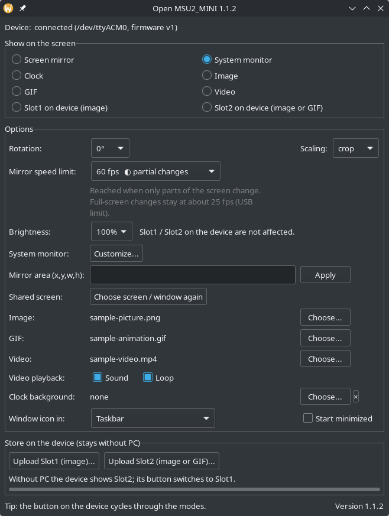
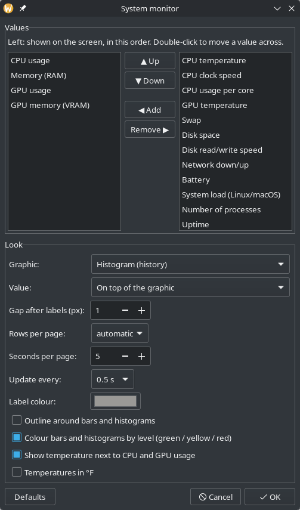

# Open MSU2_MINI

Open-source driver and control app for the **MSU2 / MSU2_MINI** USB screen, a 160×80
pixel LCD (ST7735S) driven by a WCH CH32X035 microcontroller, USB ID `1a86:fe0c`.
It replaces the vendor's Windows-only demo tool and runs on **Linux, Windows and macOS**.

- **Screen mirroring at up to ~60 fps** (the vendor tool manages about 20). You can mirror
  a whole monitor, a window, or a part of the screen.
- **Customisable system monitor** with 17 values: CPU, per-core load, clock speed, GPU, VRAM,
  temperatures, RAM, swap, disk space and speed, network, battery, load, processes, uptime and
  time. Each with a bar, a history graph (histogram) or no graphic, the number before,
  behind or on top of it, in any order, with pages when they don't fit on one screen.
- **Clock**, **pictures** and **animated GIFs**.
- **Brightness** from 10 % to 100 % (the picture is darkened: the MSU2_MINI's firmware has
  no backlight control, see [Protocol](#protocol)).
- **Videos**, optionally with sound (on the computer's speakers, in sync with the picture)
  and in a loop. Decoded by [ffmpeg](https://ffmpeg.org), every format it knows (Linux:
  the system's package; Windows: `winget install Gyan.FFmpeg`). On macOS MP4/MOV with
  H.264 plays without it, other formats (WebM, MKV, AVI, HEVC, ...) need ffmpeg installed.
- **Two slots on the device**: Slot1 holds an image, Slot2 an image or a GIF. Without a PC
  the device shows Slot2 by itself, and its button switches to Slot1.
- **Rotation by 0°, 90°, 180° or 270°.** At 90° and 270° the screen can stand upright; the
  system monitor and the clock then use portrait layouts.
- The **button on the device** cycles through all modes (Image, GIF and Video once a file is
  chosen for them).
- **Native window** that follows your desktop theme: GTK on Linux, Win32 with dark mode on
  Windows, Cocoa on macOS. Optionally with an icon in the notification area (system tray)
  and started minimized.
- **Command line** for running without a window (autostart), flashing and benchmarking.






> Not affiliated with the hardware's manufacturer. The USB protocol was worked out from the
> behaviour of the vendor's tool; see [Protocol](#protocol).

## Install

Download the executable for your system from the
[Releases](../../releases) page, or [build it yourself](#building).

| System | Notes |
|---|---|
| **Linux** x86_64 | Packages for Ubuntu/Debian, Fedora/openSUSE and Arch, or a single executable; see [Linux](#linux) below. |
| **Windows** 10/11 | Just run the `.exe`; no driver needed. For videos install [ffmpeg](https://ffmpeg.org): `winget install Gyan.FFmpeg` (or put `ffmpeg.exe` next to the program). |
| **macOS** | Allow "Screen Recording" for the app (or your terminal) to mirror the screen. Videos in formats other than MP4/H.264 need ffmpeg (`brew install ffmpeg`). |

### Linux

The Linux version uses the libraries of your distribution instead of bringing its own:
GTK 3 (window), PipeWire (screen mirroring), ALSA (video sound, played through PipeWire or
PulseAudio), Ayatana AppIndicator (tray icon), libSM, libudev, and **ffmpeg** for decoding
videos and their sound. It needs glibc 2.39 or newer (distributions from 2024 on; Ubuntu
22.04, Debian 12 and older are not supported).

**Packages (recommended).** Download the package for your distribution from the
[Releases](../../releases) page and install it; the package manager installs the libraries
it needs. The packages also add an app-menu entry and a udev rule that gives the logged-in
user access to the screen (no group membership or re-login needed; replug the screen once
if it was connected during the installation).

| Distribution | Package | Install |
|---|---|---|
| **Ubuntu** 24.04+, **Debian** 13+, Linux Mint 22+, Pop!_OS 24.04+ | `.deb` | `sudo apt install ./open-msu2-mini_*_amd64.deb` |
| **Fedora** 41+ | `.rpm` | `sudo dnf install ./open-msu2-mini-*.x86_64.rpm ffmpeg-free` |
| **openSUSE** Tumbleweed | `.rpm` (the same file) | `sudo zypper install --allow-unsigned-rpm ./open-msu2-mini-*.x86_64.rpm` |
| **Arch**, Manjaro, EndeavourOS | `.pkg.tar.zst` | `sudo pacman -U open-msu2-mini-*.pkg.tar.zst && sudo pacman -S --needed ffmpeg` |
| Any other (glibc 2.39+) | `.AppImage` | `chmod +x open-msu2-mini-*-x86_64.AppImage`, then start it |

The **AppImage** brings the tray-icon libraries and libSM along, and uses GTK 3, PipeWire,
ALSA and ffmpeg from the system. It does not install the udev rule; see *Device access*
below.

**Single executable.** Alternatively download `open-msu2-mini-linux-x86_64` and install the
libraries yourself (most are already there on a desktop system):

| Distribution | Command |
|---|---|
| **Ubuntu** 24.04+, **Debian** 13+, Linux Mint 22+, Pop!_OS 24.04+ | `sudo apt install libgtk-3-0t64 libpipewire-0.3-0t64 libayatana-appindicator3-1 libasound2t64 libsm6 ffmpeg` |
| **Fedora** 41+ | `sudo dnf install gtk3 pipewire-libs libayatana-appindicator-gtk3 alsa-lib libSM ffmpeg-free` |
| **Arch**, Manjaro, EndeavourOS | `sudo pacman -S --needed gtk3 libpipewire libayatana-appindicator alsa-lib libsm ffmpeg` |
| **openSUSE** Tumbleweed | `sudo zypper install libgtk-3-0 libpipewire-0_3-0 libayatana-appindicator3-1 libasound2 libSM6 ffmpeg` |

Then `chmod +x open-msu2-mini-linux-x86_64` and run it, or install it for your user with
`packaging/linux/install.sh [--udev] [--autostart]` from a copy of this repository: it
copies the program to `~/.local/bin`, adds an app-menu entry and optionally autostart and
the udev rule, and reports missing libraries. **Device access:** without the udev rule (packages install it), add yourself to the
group that owns serial ports and log in again: `sudo usermod -aG dialout $USER` (Arch:
`uucp` instead of `dialout`).

**ffmpeg** is only needed for the video mode. Fedora's `ffmpeg-free` and openSUSE's
`ffmpeg` play common videos (tested: H.264 with AAC, VP9 with Opus). For HEVC and other
patented formats, install the full ffmpeg from [RPM Fusion](https://rpmfusion.org) (Fedora:
`sudo dnf swap ffmpeg-free ffmpeg --allowerasing`) or
[Packman](https://en.opensuse.org/Additional_package_repositories#Packman) (openSUSE).

## Usage

Start the program without arguments to open the window. On the command line:

```sh
open-msu2-mini                          # window
open-msu2-mini run                      # no window, saved settings (for autostart)
open-msu2-mini run stats                # modes: mirror stats clock image gif video slot1 slot2
open-msu2-mini run --gif cat.gif --brightness 50   # GIF mode at half brightness
open-msu2-mini run --video clip.mp4 --sound --loop=false   # play once, with sound
open-msu2-mini run mirror --region 0,0,1280,640 --fps 60
open-msu2-mini run stats --rotate 90    # rotation: 0, 90, 180 or 270 (works with run/show/flash)
open-msu2-mini run mirror --fps 0.5     # slowest: one picture every two seconds
open-msu2-mini run mirror --monitor 1   # Windows/macOS: mirror the second monitor
open-msu2-mini run mirror --reselect    # Linux: choose the shared screen/window again
open-msu2-mini show cat.gif             # show a picture or GIF
open-msu2-mini flash slot2 clip.gif     # Slot2 on the device: a GIF, a picture, or a folder A0.png ... A35.png
open-msu2-mini flash slot1 photo.jpg    # Slot1 on the device: a picture
open-msu2-mini test                     # test pattern
open-msu2-mini sysinfo                  # print what the system monitor reads on this computer
open-msu2-mini bench --mirror           # measure the frame rate
open-msu2-mini --help
```

- **Wayland:** the first time you mirror, your desktop asks which screen or window to
  share. The choice is remembered.
- **Speed limit:** the window marks each choice by what the device can deliver:

  | Mark | Speed limit | Meaning |
  |---|---|---|
  | eco | 0.5–5 fps | Saves CPU and USB bandwidth; motion looks choppy |
  | ✓ full screen | 10–24 fps | Reached for any content, even full-screen video |
  | ◐ partial changes | 30–60 fps | Reached when parts of the screen change; full-screen changes stay at ~25 fps |
  | ⚠ small changes only | 90–120 fps | Above the panel's ~61 fps limit: only small changes (mouse, small video) reach it; more CPU |

- **System monitor:** choose the values, their order and the look under *System monitor →
  Customize…* in the window (or edit the `stats` section of the settings file).
- **Slots on the device:** *Upload Slot1 (image)…* and *Upload Slot2 (image or GIF)…* keep
  a picture and a picture or GIF in the device's flash; the modes *Slot1 on device* and
  *Slot2 on device* show them. Without a PC the device shows Slot2, and its button switches
  to Slot1. Brightness does not affect them, and they are turned when they are written, so
  upload them again after switching between landscape and portrait.
- **System monitor values:** `open-msu2-mini sysinfo` prints every value as this computer
  reports it (no device needed); please include its output when reporting wrong values. On
  Windows, temperatures are usually not available: Windows reports them only to programs
  running as administrator, and many PCs not at all.
- **Scaling:** the panel is 2:1. `crop` fills it and cuts off the edges, `fit` adds black
  bars, `stretch` distorts.
- **Window icon:** under *Window icon in* choose the taskbar, the notification area or both.
  With the notification area only, the minimized window leaves the taskbar; click the icon
  (or use its menu) to bring it back. *Start minimized* opens the window minimized, or only
  as the icon. On GNOME the tray needs the "AppIndicator" extension.
- **Settings:** stored in `~/.config/open-msu2-mini/` (Linux), `%APPDATA%\open-msu2-mini\`
  (Windows) or `~/Library/Application Support/open-msu2-mini/` (macOS).
- **Window and background instance:** if `open-msu2-mini run` is running in the background,
  the window takes the device over while it is open and starts the background instance
  again when closed.

## Performance

The link to the panel has two hard limits: about **890 KB/s** over USB, and about **16 ms**
for the LCD to draw a full frame. The vendor tool always sends complete frames. This app:

1. **Sends only changed areas.** Each frame is compared with what the panel shows, and only
   the changed rows and columns are sent.
2. **Uses block deltas.** Pixels travel through a 256-byte buffer on the device that keeps
   its content between blocks. Each block is sent either as "changes against the previous
   block" or as "fill pattern + changes", whichever is smaller.
3. **Streams without waiting for acknowledgements.** A button poll every 200 ms provides
   flow control and keeps the link alive; the device goes offline after ~5 s of silence.
4. **Captures cheaply.** Frames are scaled to 160×80 in the capture thread: PipeWire on
   Linux, DXGI desktop duplication on Windows, AVFoundation on macOS.

Measured on the device with `open-msu2-mini bench`:

| Content | Vendor method | Open MSU2_MINI |
|---|---|---|
| Random noise (worst case) | 23.5 fps | 24.8 fps |
| Scrolling picture | 30.3 fps | 32.7 fps |
| Video in a 64×36 window | 40.2 fps | 134.9 fps |
| Only the mouse pointer moves | 47.3 fps | ~2600 updates/s |
| Mirroring a real desktop (KDE, 2560×1440) | ~20 fps | 43–55 fps |

Full-screen video, where every pixel changes, stays near 25 fps: that is the USB limit for
lossless frames.

## Building

You need Rust (1.95+), CMake and a C++ compiler. wxWidgets is downloaded and compiled
automatically on the first build, which takes a few minutes.

- **Linux:** additionally `clang`, Ninja and the development packages of the libraries
  listed under [Install](#linux) (plus OpenSSL, used to download wxWidgets). Install
  [Rust with rustup](https://rustup.rs) if your distribution's Rust is older than 1.95.

  | Distribution | Build dependencies |
  |---|---|
  | Ubuntu 24.04+, Debian 13+ | `sudo apt install build-essential cmake ninja-build clang libclang-dev pkg-config libgtk-3-dev libpipewire-0.3-dev libayatana-appindicator3-dev libudev-dev libasound2-dev libssl-dev libxkbcommon-dev libgl1-mesa-dev libglu1-mesa-dev libsm-dev libxtst-dev libjpeg-dev libtiff-dev libexpat1-dev` |
  | Fedora | `sudo dnf install gcc-c++ cmake ninja-build clang-devel pkgconf-pkg-config gtk3-devel pipewire-devel libayatana-appindicator-gtk3-devel systemd-devel alsa-lib-devel openssl-devel libxkbcommon-devel mesa-libGL-devel mesa-libGLU-devel libSM-devel libXtst-devel libjpeg-turbo-devel libtiff-devel expat-devel` |
  | Arch | `sudo pacman -S --needed base-devel cmake ninja clang gtk3 libpipewire libayatana-appindicator alsa-lib openssl libxkbcommon mesa glu libsm libxtst` |
  | openSUSE Tumbleweed | `sudo zypper install gcc-c++ cmake ninja clang-devel pkg-config gtk3-devel pipewire-devel libayatana-appindicator3-devel systemd-devel alsa-devel libopenssl-devel libxkbcommon-devel Mesa-libGL-devel glu-devel libSM-devel libXtst-devel libjpeg8-devel libtiff-devel libexpat-devel` |
- **Windows:** Visual Studio Build Tools and Ninja; build from a "Developer PowerShell".
- **macOS:** Xcode command line tools, plus `brew install cmake ninja`.

```sh
cargo build --release                       # target/release/open-msu2-mini
cargo build --release --no-default-features # without the window (no wxWidgets)
```

**Linux and Windows executables from Linux, with Docker** (Ubuntu 24.04 build environment;
Windows is cross-compiled with Zig):

```sh
build/build-all.sh   # dist/: Linux and Windows executables, .deb, .rpm and Arch package
build/package.sh     # only the packages, from dist/open-msu2-mini-linux-x86_64 (nfpm, packaging/linux/nfpm.yaml)
MSU2_APPIMAGE=1 build/package.sh   # also the AppImage (downloads appimagetool; CI always builds it)
```

GitHub Actions (`.github/workflows/ci.yml`) builds Linux, Windows and macOS (Intel and
Apple Silicon) on every push. A `v*` tag publishes the executables as a release.

### Project layout

| Path | Contents |
|---|---|
| `src/device.rs` | USB protocol, frame encoder, flash access |
| `src/controller.rs` | Background thread: connection, keep-alive, button, modes |
| `src/capture/` | Screen capture (portal + PipeWire on Linux, xcap on Windows/macOS) |
| `src/stats.rs` | System monitor |
| `src/render.rs`, `src/scale.rs` | Clock, pictures, text; scaling to the panel or a portrait canvas |
| `src/video.rs`, `src/audio.rs` | Video playback and its sound: ffmpeg (Linux, Windows; macOS: OpenH264 and Symphonia, ffmpeg for other formats), output with cpal |
| `src/gui.rs`, `src/gui_stats.rs` | Window and system monitor settings (wxWidgets) |
| `src/main.rs` | Command line, benchmark |
| `build/` | Docker build environment and scripts |
| `packaging/linux/` | Installer, desktop entry, udev rule |

## Protocol

The device is a USB CDC-ACM serial port (`/dev/ttyACM*`, `COMx`, `/dev/cu.usbmodem*`).
The baud rate is ignored. Every command is 6 bytes. Pixels are RGB565, big-endian.

| Bytes | Meaning |
|---|---|
| `00 'M' 'S' 'N' v v` | Sent every 100 ms by the device while offline (`vv` = firmware version, ASCII) |
| `00 'M' 'S' 'N' 'C' 'N'` | Host handshake; the device echoes it back |
| `02 00 xh xl yh yl` | Set the position |
| `02 01 wh wl hh hl` | Set the size |
| `02 02 fh fl bh bl` | Set the foreground and background colour |
| `02 03 07 00 00 00` | Start a pixel transfer into the rectangle (acknowledged) |
| `02 04 aa bb cc dd` | Fill the 256-byte block buffer with a 32-bit pattern |
| `04 ii d0 d1 d2 d3` | Put 4 bytes at word `ii` (0–63) of the block buffer |
| `02 03 08 01 00 00` | Draw the 256-byte block (`02 03 08 00 nn 00`: only `nn` bytes) |
| `02 03 00 ph pl 00` | Show a picture stored in flash at page `p` |
| `02 03 01 ph pl 00` | Show a 1-bit picture from flash in the set colours |
| `02 03 0A rr 00 00` | Orientation (0 = normal, 1 = rotated 180°) |
| `02 03 12 dh dl 00` | Backlight PWM `d` = 0–1000 on the MSU2 PRO; the MSU2_MINI ignores it (see below) |
| `02 03 0B ch cl 00` | Fill the rectangle with a colour |
| `03 00 a2 a1 a0 00` | Read the flash byte at address `a`; the reply's last byte is the value |
| `03 02 ph pl nh nl` | Erase `n` flash pages starting at page `p` |
| `03 03 p2 p1 p0 01` | Write the block buffer to flash page `p` |
| `08 ch 00 00 00 00` | Read ADC channel `ch` (channel 9 = push button; pressed = lower value) |

Further notes:

- The block buffer keeps its content after a block is drawn or written to flash.
- Without traffic for about 5 seconds, the device returns to offline mode and announces
  itself again.
- Flash: P25D80, 1 MB, 4096 pages of 256 bytes. Stock layout (pages): `0–3599` offline
  animation (36 × 100), `3651` 32×64 ASCII font, `3820` boot logo (1-bit, 160×68), `3826`
  offline still picture, `3926` "album" picture of the vendor demo (not shown by the firmware
  itself), `4026+` digit glyphs.
- **No backlight control on the MSU2_MINI:** neither the PRO's `02 03 12` nor any other
  unused display command (`02 03 0C`–`1F`, `02 05`–`0F`, each with all-`00` and all-`FF`
  values) changes the brightness, and the V1.0 firmware drives no PWM for the backlight.
  The app therefore darkens the picture instead. `open-msu2-mini probe-backlight` (hidden)
  repeats this test with the test number shown on the screen, for other firmware versions.
- Offline, the firmware shows the entries of a directory at address `0x0FFE00` (32 bytes
  each: flags, frame interval, frame count, start page, size): the animation at page 0 and
  the still picture at page 3826; the device's button switches between them. Thanks to
  [kxn/msu2-ip-display](https://github.com/kxn/msu2-ip-display) for the firmware analysis.

## License

MIT, see [LICENSE](LICENSE). The bundled DejaVu fonts are under the
[DejaVu font license](assets/DejaVu-LICENSE). The executables include
[wxWidgets](https://www.wxwidgets.org/) (wxWindows Library Licence).
